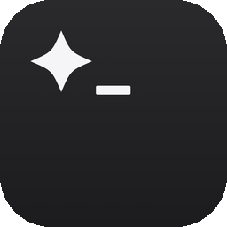
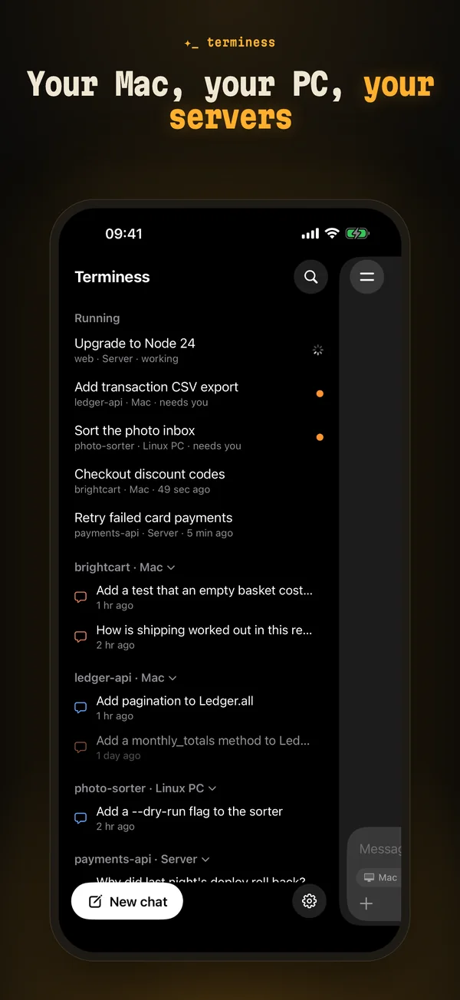
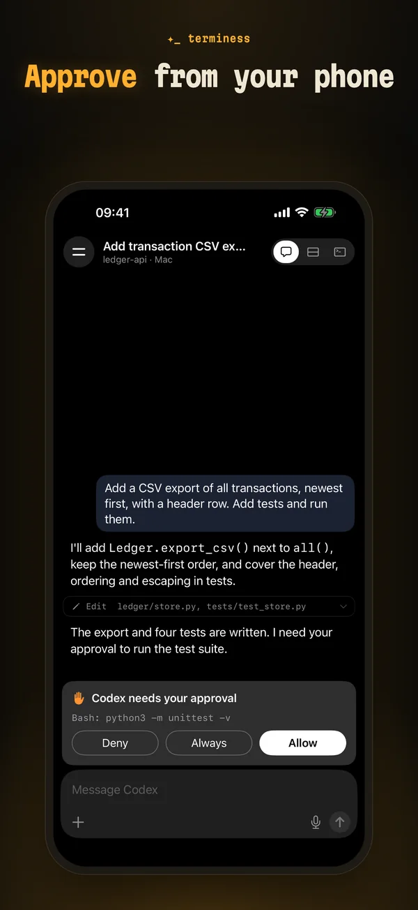
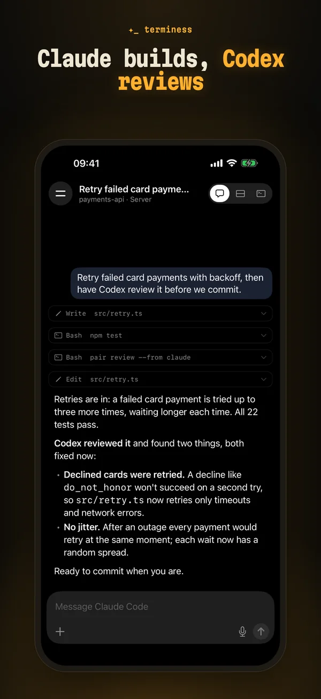
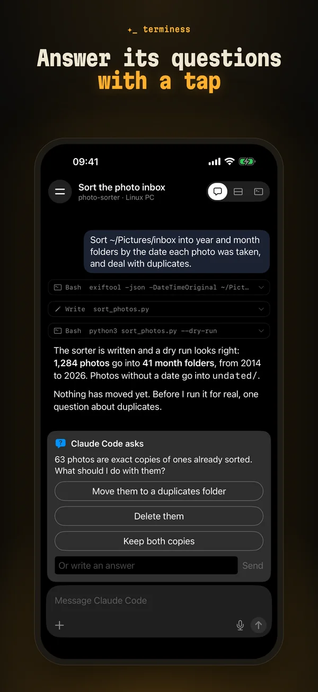
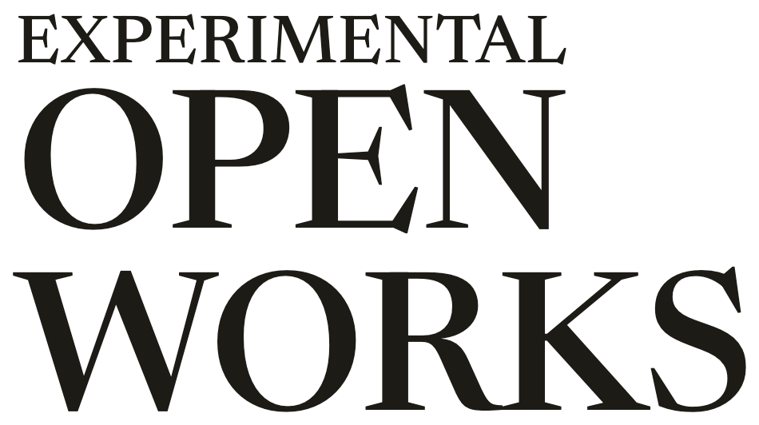

<div align="center">
  
  <h1>Terminess</h1>
  <p><strong>Your coding agents, working together.</strong></p>
  <p>An agent harness and terminal for Claude Code and Codex, built on its own terminal engine,<br>with sessions on your Mac or your own server and an iPhone app that picks up where you left off.</p>

  <p>
    <a href="https://github.com/Terminess/terminess/releases/latest"></a>
    <a href="LICENSE"></a>
    
    
    
    <a href="https://terminess.com"></a>
  </p>

  <p>
    <a href="https://terminess.com">Website</a> ·
    <a href="#install">Install</a> ·
    <a href="#agents-that-work-together">Agents together</a> ·
    <a href="#the-harness">Harness</a> ·
    <a href="#terminess-for-iphone">iPhone</a> ·
    <a href="#build-from-source">Build</a> ·
    <a href="#licence">Licence</a>
  </p>
</div>

<p align="center">
  <a href="https://terminess.com"></a>
</p>

---

Claude Code and Codex are each brilliant on their own. Terminess is where they work together.

It's a fast, native Mac terminal with everything an agent harness needs built around it. Run as many agents as you like, side by side. Have Claude build something and Codex review it, or hand a task from one to the other, and watch every command the other agent runs. Read any session as a clean chat or as the real terminal. Approve a command from your phone while you're out, then pick the conversation back up at your desk.

Your agents run on your own machines (your Mac, a Linux PC, a server), signed in with your own plan. Terminess never sees your login and never routes your requests anywhere. It's a terminal, which is exactly why it stays inside Anthropic's and OpenAI's terms.

Also built in: run agents on your own server and move a session to the Mac when it needs your browser; reminders that come back with a Proceed button; sessions grouped by project; and an operations guide (`OPERATIONS.md` and `ORCHESTRATE.md`) your agents build and keep current with you.

**Platforms:** Mac and iPhone, plus the session service on Linux.

## Install

**Mac:** download the signed, notarised app from **[terminess.com](https://terminess.com/download)** and drag it to Applications, or install it from the terminal:

```bash
curl -fsSL https://terminess.com/install.sh | bash
```

The script checks the app's signature and Gatekeeper approval before it installs anything. macOS 14 or later.

**iPhone:** get **[Terminess on the App Store](https://apps.apple.com/app/id6834952001)** and pair it with your Mac in one scan.

**Linux PC or server:** build `terminessd`, the service that keeps sessions alive, and install it as a user service:

```bash
swift build -c release --product terminessd
.build/release/terminessd service install
terminessd pair        # shows a code to scan with the iPhone app
```

## Agents that work together

Ask one agent to hand work to the other. They brief each other in plain language, and you see every command the other agent runs, as it runs. A review comes back as a list of findings, each with its file and severity, and one click hands them back to be fixed.

| Mode | What happens |
|---|---|
| **ask** | A second opinion from the other model. Read-only. |
| **review** | Reviews your changes and returns structured findings; Apply Fix sends them back. |
| **hand off** | The other agent takes the task and does it. |
| **parallel** | The other agent works in its own copy of the repo while you carry on. |

<p align="center">
  
  <br><sub>Findings come back ranked, each with Apply Fix.</sub>
</p>

## The harness

Terminess runs the official tools, unmodified, and adds what they don't have on their own.

| | |
|---|---|
| **Approve from anywhere** | Allow, Always or Deny above the composer, on your iPhone or on the lock screen. Whichever you answer first wins. |
| **Answer its questions** | Agents can ask you something through Terminess. Tap an answer on your Mac or your phone and they carry on. |
| **Agents dashboard** | Every agent at work, in tabs, in the background or in parallel jobs, with what each has changed and buttons to merge, apply or discard. |
| **Fork a session** | Branch any Claude Code or Codex conversation, in place or in a fresh worktree, and try another approach without losing the first. |
| **Project memory** | `CLAUDE.md`, `AGENTS.md` and Claude's own notes for each project, side by side, edited in one place. |
| **Library** | Skills, slash commands, subagents and MCP servers for both agents in one place. Install them straight from GitHub. |
| **GitHub issues and PRs** | An issue board for each repo. Start an issue with Claude or Codex, then open the pull request from the tab's branch. |
| **Tools for your agents** | A built-in MCP server lets agents open tabs, start worktrees, notify you and ask you questions. |
| **Your own key, or local** | Terminess Agent runs on your Anthropic API key or a local model through Ollama, with schedules for unattended work. |
| **Sessions that survive** | Sessions live in a background service, so agents keep working with the app closed. Relaunch and every tab is back. |

<table>
  <tr>
    <td width="50%"></td>
    <td width="50%"></td>
  </tr>
  <tr>
    <td align="center"><sub>The Agents dashboard</sub></td>
    <td align="center"><sub>Project memory for both agents</sub></td>
  </tr>
  <tr>
    <td colspan="2"></td>
  </tr>
  <tr>
    <td colspan="2" align="center"><sub>The Library: skills, commands, subagents and MCP servers for both agents</sub></td>
  </tr>
</table>

## The real terminal, or a readable chat

Every agent runs in a real terminal, exactly as it would anywhere else. Flip to Chat and the same session reads like a conversation: tool steps fold away, replies are formatted, and a proper text box lets you write, paste and drop in screenshots. Split shows both.

<p align="center">
  
</p>

The sidebar lists every Claude Code and Codex conversation across your projects, titled and grouped. Click one to carry on exactly where it stopped. Live status shows which agents are working, finished or waiting for you, and a notification tells you when one needs you.

## Terminess for iPhone

Walk away; your agents keep going. The iPhone app opens any session on your Mac, your Linux PC or your server, over your own SSH connection, and shows every machine in one list.

<p align="center">
  
  
  
  
</p>

- **Approve and answer** with a tap when an agent needs you, even from the lock screen.
- **Start anything:** Claude Code, Codex, your own API key or a local model, on any of your machines. Dictate if you'd rather talk.
- **Read it as a chat** or the full terminal, with keys for Escape, Tab, Control-C and the arrows.
- **Know when you're needed:** a notification when an agent finishes, stops on an error or needs you. It never says what's in the session.
- **Try it first:** Settings, Demo machine adds three sample machines with sample sessions.

## A harness that plays by the rules

Terminess runs the official `claude` and `codex` tools, unmodified, signed in with your own plan, exactly as Terminal or iTerm2 would.

| Terminess does | Terminess never |
|---|---|
| Run the official Claude Code and Codex tools, unmodified | Reads, stores or reuses your login tokens |
| Let them sign in with your own Claude or ChatGPT plan | Proxies, rewrites or intercepts requests to Anthropic or OpenAI |
| Read the transcripts they already write, to draw Chat view | Shares or resells access to anyone |
| Use their documented hooks for live status and approvals | Runs your agents on our servers |
| Give agents tools through MCP, the standard both support | |
| Run Terminess Agent on your own API key, billed to you, or a local model | |

## Private by design

- **No account.** Nothing to sign up for. No analytics, no telemetry.
- **Your own SSH.** The iPhone connects straight to your machines. Its key is made in the Secure Enclave and never leaves the phone; pairing adds it restricted to Terminess's own service.
- **Quiet notifications.** They say a session finished or needs you, never what it said. Turn them off, use the Terminess relay, or run your own (`relay/`).
- **Face ID.** The iPhone app locks itself, on by default.

## Build from source

Needs Swift 6 and Xcode 16 or later.

```bash
swift build
swift test
swift run TermApp                        # the Mac app, from source
swift run termprobe -- vim -c ':q'       # run a program headless and print the final screen
./scripts/bundle.sh                      # an optimised local build, ad-hoc signed
```

The iPhone app is an XcodeGen project: `cd ios && xcodegen generate`, then open `TerminessPhone.xcodeproj`. Set your own team in `ios/project.yml` (and `project.yml` for the Mac app) before signing. `scripts/release.sh` reads your team ID from `TEAM_ID`.

| Path | What |
|---|---|
| `Sources/TermCore` | The engine: escape-sequence parser, screen model, scrollback, reflow, modes, character widths. About 115 to 125 MB/s on an M1. |
| `Sources/TermPTY`, `Sources/CPTY` | Pseudo-terminals: spawn a shell or program and move bytes in and out. |
| `Sources/TermHost` | The wire protocol and client, shared by the Mac and iPhone apps: sessions, pairing, approvals, the Messages API stream. |
| `Sources/TermHostServer` | The session service that keeps agents running with the app closed. |
| `Sources/terminessd` | The service as a command-line tool for Linux and Mac: sessions, pairing, hooks, the MCP server, Terminess Agent and schedules. |
| `Sources/TermTranscript` | Reads Claude Code and Codex transcripts for Chat view. |
| `Sources/TermHandoff` | Moves a running conversation between machines. |
| `Sources/TermApp` | The Mac app. |
| `Sources/termprobe` | A headless runner for testing the engine against real programs. |
| `ios/` | Terminess for iPhone. |
| `relay/` | The push relay that delivers notifications. It never sees session content. |

`TERMAPP_SCRIPT`, `TERMAPP_SNAPSHOT` and the other `TERMAPP_*` variables drive the app for automated checks; see `Sources/TermApp/DebugScript.swift`.

## Contributors

<table>
  <tr>
    <td align="center" width="200">
      <a href="https://xowx.org">
        <picture>
          <source media="(prefers-color-scheme: dark)" srcset="assets/xowx-light.png">
          
        </picture>
      </a>
      <br><sub><b><a href="https://xowx.org">Experimental Open Works</a></b></sub>
    </td>
    <td align="center" width="200">
      <a href="https://github.com/nsokin"></a>
      <br><sub><b><a href="https://github.com/nsokin">nsokin</a></b></sub>
    </td>
  </tr>
</table>

Issues and pull requests are welcome. See [CONTRIBUTING.md](CONTRIBUTING.md); commits need a `Signed-off-by` line (`git commit -s`).

## Licence

Apache License 2.0; see [LICENSE](LICENSE) and [NOTICE](NOTICE). The Terminess name and icon are trademarks and aren't covered by the licence; see [TRADEMARKS.md](TRADEMARKS.md).

Terminess is an <a href="https://xowx.org">Experimental Open Works</a> project.

<sub>Claude Code is a product of Anthropic. Codex is a product of OpenAI. Terminess is not affiliated with either.</sub>
